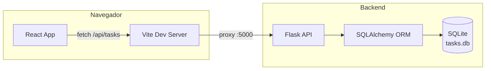

# Mis Tareas — To-Do List (Flask + React)

Proyecto final: una aplicación de lista de tareas full-stack. El backend expone una API REST en **Python/Flask** que persiste los datos en **SQLite**, y el frontend es una **React SPA** (construida con Vite y estilizada con Tailwind CSS) que consume esa API.

Permite crear tareas, editarlas, eliminarlas y moverlas entre tres estados: **pendiente**, **en proceso** y **terminada**.

## Tecnologías

**Backend**
- Python 3 + [Flask](https://flask.palletsprojects.com/) — framework web / API REST
- [Flask-SQLAlchemy](https://flask-sqlalchemy.palletsprojects.com/) — ORM
- [Flask-Cors](https://flask-cors.readthedocs.io/) — habilita peticiones cross-origin
- SQLite — base de datos embebida (un solo archivo, cero configuración)

**Frontend**
- [React 18](https://react.dev/) — librería de UI basada en componentes
- [Vite](https://vite.dev/) — servidor de desarrollo y build tool
- [Tailwind CSS 3](https://tailwindcss.com/) — estilos utilitarios

## Arquitectura

Son dos procesos independientes que se comunican por HTTP usando JSON. El frontend nunca accede a la base de datos directamente: todo pasa por la API.



- El frontend llama siempre a rutas relativas (`/api/tasks`); en desarrollo, Vite las reenvía al backend (`vite.config.js`), evitando problemas de CORS.
- El backend expone la API vía un *Blueprint* de Flask y usa SQLAlchemy para traducir operaciones Python en SQL contra SQLite.

## Estructura de carpetas

```
Todo-List-back y front/
├── backend/
│   ├── app/
│   │   ├── __init__.py       # application factory: crea y configura la app Flask
│   │   ├── config.py         # configuración (ruta de la base de datos)
│   │   ├── extensions.py     # instancia de SQLAlchemy
│   │   ├── models.py         # modelo Task (tabla de la base de datos)
│   │   └── routes/
│   │       └── tasks.py      # endpoints CRUD de la API
│   ├── requirements.txt
│   └── run.py                 # punto de entrada del servidor
└── frontend/
    ├── src/
    │   ├── components/
    │   │   ├── TaskForm.jsx   # formulario para crear tareas
    │   │   ├── TaskList.jsx   # grilla de tareas
    │   │   └── TaskCard.jsx   # tarjeta individual (ver/editar/eliminar/cambiar estado)
    │   ├── data/
    │   │   └── status.js      # definición de los 3 estados posibles
    │   ├── services/
    │   │   └── api.js         # funciones que llaman a la API (fetch)
    │   └── App.jsx             # componente raíz, maneja el estado global
    └── vite.config.js         # proxy de /api hacia el backend
```

## Endpoints de la API

| Método | Ruta | Descripción |
|---|---|---|
| `GET` | `/api/tasks` | Lista todas las tareas |
| `GET` | `/api/tasks/<id>` | Obtiene una tarea |
| `POST` | `/api/tasks` | Crea una tarea (`title` requerido) |
| `PUT` | `/api/tasks/<id>` | Actualiza título, descripción y/o estado |
| `DELETE` | `/api/tasks/<id>` | Elimina una tarea |

Estados válidos: `pendiente`, `en-proceso`, `terminada`.

## Cómo correrlo localmente

### Backend
```bash
cd backend
python -m venv venv
./venv/Scripts/activate       # Windows (macOS/Linux: source venv/bin/activate)
pip install -r requirements.txt
python run.py                 # http://localhost:5000
```

### Frontend
```bash
cd frontend
npm install
npm run dev                   # http://localhost:5173 (o el siguiente puerto libre)
```

Con ambos corriendo, abre la URL que te muestra Vite y la app queda funcionando contra el backend real.
